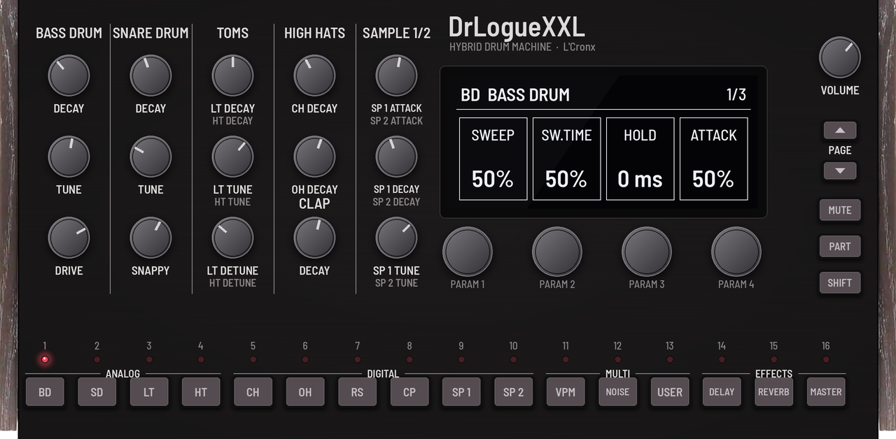
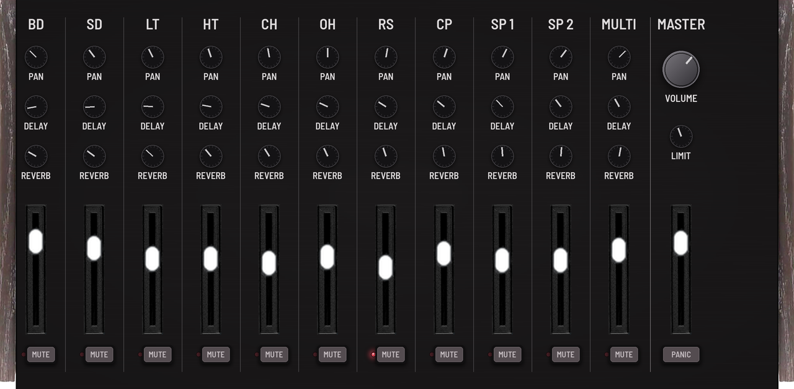
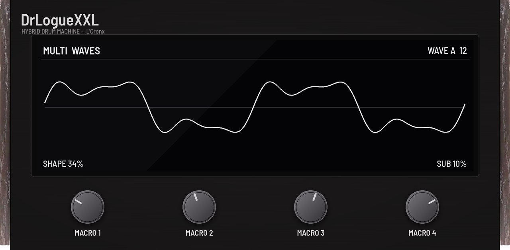

# DrLogueXXL v0.2.1

**A drumlogue-style hybrid drum machine running natively inside MPC OS on the Akai Force.**

DrLogueXXL is a VST2 instrument for MPC OS's built-in plugin host, made by L'Cronx (shown on the device as
**DrLogueXXL** by **L'Cronx**). It is built like Korg's drumlogue: eleven parts (four analogue-style drums, six
sample parts and a MULTI synth part), a send delay, a send reverb and a master effect with sidechain, on a panel in
the machine's look. It is not a port of Korg's firmware and carries none of Korg's samples: the analogue drums are
circuit-style models written for it, the 192 factory samples are synthesised when it opens, and the MULTI part hosts
open-source logue SDK units from Korg and the drumlogue community. Everything saves with your MPC project.

> [!NOTE]
> **Status: 0.2.1.** The sound engine has been played on an Akai Force (0.1.0, 2026-10-23). The 0.2 panel passes the
> mpc-vst-plugins host test, the skin check and the engine tests offline and is not yet tried on the device. Report
> anything odd under [Issues](../../issues).



*The PERFORM page, rendered offline (on the device MPC fills in the screen's text).*

## Highlights

- **Analogue-style drums:** **BD** (a saturated sine body, pitch sweep, hold, drive with its own noise tail, 16
  transients), **SD** (two tuned heads and nine snappy types: 808, 909, white, pink, bright, rattle, three lo-fi),
  **LT / HT** (two detuned tones, sweep, ten layers, three drive steps).
- **Six sample parts** (CH, OH, RS, CP, SP 1, SP 2): 192 synthesised sounds after the 808, 909, 606, CR-78, Linn,
  SP-style and FM machines, plus a USER bank of your own WAVs. Tune ±24, attack, decay, start/end (reverse), filter,
  bit reduction, drive.
- **MULTI part:** VPM (an FM-style voice with eight presets), NOISE (seven filter algorithms) and six units:
  **EffeESP32** (6-operator FM drums, 59 instruments), **Pluck** and **Waves** (Korg), **Elementish** (modal, after
  Mutable Instruments Elements), **Drupiter** (Jupiter-8 style), **Maxisynth**. Playable chromatically above a key split.
- **Effects:** delay (Stereo, Mono, Tape, each also tempo-synced; Tribe; Cassette), reverb (Room, Hall, Space, Riser,
  Submarine, Clouds, Labyrinth, Halo), master (Compressor with sidechain, Filter, Boost, EQ Three, Omni), and a
  brickwall limiter.
- **The machine's workflow:** the kit knobs, the screen with four knobs and pages for every part and effect, the 16
  part keys with LEDs, SHIFT for the second tom and sample, choke groups with priority, the parameter pop-up.
- **A mixer** with faders, pan, sends and mutes, and **four macros** (DECAY, TUNE, FILTER, SPACE) over the whole kit.
- **48 kHz inside,** like the drumlogue and its units, resampled to MPC's 44.1 kHz at the output.

## The three pages

| Page | What's on it |
| --- | --- |
| **PERFORM** | The kit knobs in five sections as on the machine (SHIFT turns TOMS to HT and SAMPLE 1/2 to SP 2), the screen with the selected part's page and its four knobs, PAGE ▲ ▼, VOLUME, SHIFT, GLOBAL, and the 16 keys: BD to SP 2, VPM, NOISE, USER, DELAY, REVERB, MASTER |
| **MIXER** | Eleven strips (PAN, DELAY and REVERB sends, the level fader, MUTE) and MASTER (limiter DRIVE and CEILING, VOLUME fader, PANIC) |
| **SCREEN** | The screen, big, with a wave picture of the selection over its four parameters, and the four macros |

| | |
| --- | --- |
|  |  |

## Quick start

1. Install it ([Installation](#installation)) and load **DrLogueXXL** (L'Cronx) on a plugin track.
2. Play the pads: with the default **Pads** note map, notes 36-46 (C1 up) are BD, SD, LT, HT, CH, OH, RS, CP, SP 1,
   SP 2 and MULTI.
3. Turn the kit knobs on **PERFORM**; each one pops up on the screen.
4. Press **BD**, then turn the four knobs under the screen; **PAGE ▼** for more (transient, filter, the mix).
5. Press **USER** and pick a unit on the screen's first knob; play notes from C3 up for the MULTI part.
6. On **MIXER**, set levels and sends; on **SCREEN**, turn **SPACE** and **DECAY**.

The [user guide](docs/USER_GUIDE.md) explains every control.

## Documentation

| Document | What's in it |
| --- | --- |
| [User guide](docs/USER_GUIDE.md) | Install, the note maps, every page, part and effect, the macros, GLOBAL, Q-Links, your own samples, troubleshooting |
| [Voices](docs/VOICES.md) | What the hardware does and how each part is modelled |
| [Vendored code](src/VENDORED.md) | Where every third-party piece comes from, its licence and what was changed |
| [Changelog](CHANGELOG.md) | What changed in each version |

## Requirements

- An **Akai Force** (first generation). Other first-generation MPC OS units (MPC Live / Live II, One, X, Key 61)
  should work but are untested.
- **Root SSH access** to the device, for example through MockbaMod. Stock MPC OS can't install third-party plugins.
- **MPC OS 3.x.** The skin uses the 3.x format.

## Installation

Download `DrLogueXXL-<version>-mpc-armv7.zip` from [Releases](../../releases), or build it (below). Unzip it and follow
the `INSTALL.md` inside. In short:

```
scp -r DrLogueXXL-<version> root@<device-ip>:/tmp/
ssh -t root@<device-ip> sh /tmp/DrLogueXXL-<version>/install.sh
```

The installer asks for confirmation (`-y` skips it), **stops MPC** (save your project first), copies the plugin to
`/sdcard/Synths/L'Cronx - VST - DrLogueXXL/`, backs up and edits `MPC.settings`, and starts MPC again. Running it again
upgrades in place. `uninstall.sh` removes it the same way.

Your own samples go in the plugin's `Samples` folder (`/sdcard/Synths/L'Cronx - VST - DrLogueXXL/Samples/`): WAV, any
bit depth and rate, mono or stereo, up to 128 files of 4 s. They appear in the USER bank; press RESCAN (GLOBAL) after
adding files.

## Building

Linux or WSL with Python 3 (+ Pillow), gcc and [Zig](https://ziglang.org/) (`pip install ziglang pillow`). No Docker.

```
git clone --recursive https://github.com/sunskiefer/DrLogueXXL
cd DrLogueXXL
./build.sh            # build/arm/drloguexxl.so + the skin -> build/package/
test/run_tests.sh     # the framework's host test and the engine test, under ASan/UBSan
```

The tools:
- `tools/gen_params.py`: the single source of the parameter list (writes `params.json` and `src/param_ids.h`). MPC
  stores automation by parameter index, so parameters are only ever appended.
- `tools/ui.py`: the three pages (geometry, Q-Links, every control), from the panel look of `tools/sketch.py`; it writes
  `layout.conf` and builds the skin after the framework's generator.
- `tools/sketch.py`: the panel's drawing (brushed panel, wood ends, caps, keys, LEDs, the screen) and the review
  sketches.

## Testing

Offline, every build (`test/run_tests.sh`, and in CI):
- **The framework's host test:** two instances, names, set/get, option and whole-number stepping (Q-Link and wheel),
  popups, notes into audio, the chunk, CC and NRPN, two threads writing while it renders.
- **The engine test:** every part alone and in a groove through every delay, reverb and master type; every MULTI
  source; choke and mute; the saved state round trip (values and USER sample names); the screen's pages for all 17
  selections, the knobs' stepping, the pop-up, the MULTI source keys, the macros; a random sweep of every parameter
  while playing (no NaN, no runaway).
- **The parts' own tests**, run while developing them (`test/analog_test.cc`, `test/samples_test.cc`, `test/multi_test.cc`, `test/fx_test.cc`):
  pitch and decay ranges, every option, retrigger without clicks, the WAV loader against broken files, every unit
  rendered next to other instances (no shared state), every effect's stability and tails.
- **ARM:** the engine test also passes as an armv7 binary (no NEON, like the plugin) under QEMU.

CPU: a busy groove with delay, reverb and the compressor takes about 45 µs per 128-frame block on an x86 core. The
device's budget is 2902 µs per block; the device check (`mpc-vst-plugins tools/bench.sh`) is still to do.

## Related projects

- [mpc-vst-plugins](https://github.com/sd88me/mpc-vst-plugins) by sd88me: the framework DrLogueXXL is built on, and the
  plugin catalog.
- [LXRXXL ZYNTH](https://github.com/sunskiefer/LXRXXL-ZYNTH): the mixer faders come from it.
- [PlateauXXL](https://github.com/sunskiefer/PlateauXXL) and [RMXXXL](https://github.com/sunskiefer/RMXXXL): the
  brickwall limiter.
- [korginc/logue-sdk](https://github.com/korginc/logue-sdk) and [cldmnky/drumlogue-units](https://github.com/cldmnky/drumlogue-units):
  the units.

## License

DrLogueXXL is released under the **GNU GPL v3.0 or later** ([LICENSE](LICENSE)). Third-party components keep their own
licenses (below and in [src/VENDORED.md](src/VENDORED.md)).

## Credits

- **Developer:** L'Cronx.
- **Artwork by Suns Kiefer** (the panel, a collage in the drumlogue's look; the mixer faders from LXRXXL ZYNTH).
- **Korg logue SDK** (BSD-3-Clause, © KORG Inc.): the drumlogue unit API headers, and the NTS-1 mkII **Pluck** and
  **Waves** units (Waves plays wave tables made for DrLogueXXL; the hardware's tables are not included).
- **EffeESP32:** Evgeny Aslovskiy "Copych", [ESP32-S3 FM Drum Synth](https://github.com/copych/ESP32-S3_FM_Drum_Synth)
  (MIT), via Federico Gennari's drumlogue port; its controller is written for DrLogueXXL.
- **Elementish, Drupiter, Clouds reverb FX:** cldmnky, [drumlogue-units](https://github.com/cldmnky/drumlogue-units)
  (Apache-2.0 / MIT), with Mutable Instruments code by Emilie Gillet (MIT); Drupiter's DSP after Bristol (GPL).
- **Maxisynth:** boochow, [maxisynth](https://github.com/boochow/maxisynth) (MIT), on the
  [Maximilian](https://github.com/micknoise/Maximilian) library (MIT).
- **Tribe, Cassette, Labyrinth, Halo, Omni:** written for DrLogueXXL after the descriptions of Federico Gennari's
  drumlogue effects (none of their code is used).
- **Brickwall limiter:** from RMXXXL / PlateauXXL by L'Cronx (GPL-3.0-or-later).
- **VST2 wrapper, skin generator, installer:** sd88me, [mpc-vst-plugins](https://github.com/sd88me/mpc-vst-plugins)
  (MIT), as a submodule in `third_party/mpc-vst-plugins`.
- **Fonts:** Barlow Semi Condensed by Jeremy Tribby and Titillium Web, SIL Open Font License 1.1 (`art/fonts/`).

"drumlogue" is a trademark of KORG Inc. DrLogueXXL is not affiliated with or endorsed by KORG, Mutable Instruments,
Roland or Akai Professional; their names only say what a part or unit was made after.
